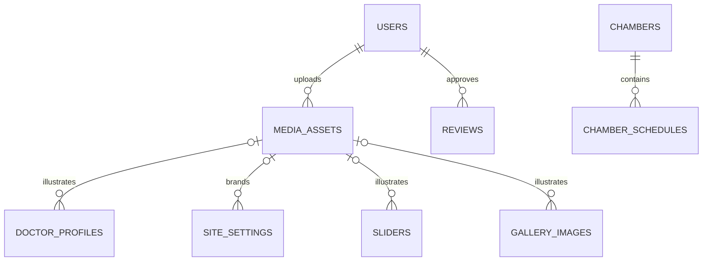

# Phase 1 — backend foundation

## Scope and architecture

The backend is a Laravel 13 application in `backend/`, targeting PHP 8.3+ and MySQL 8.0+ with `utf8mb4` for English and Bangla text. The existing five-page static website stays in `dist/` until its planned Blade conversion in Phase 5. No website content is fetched from the reference server at runtime.

The administrator interface will use AdminLTE in Phase 2. There is no public registration, admin login, admin dashboard or content editing endpoint in Phase 1. The only browser routes are the foundation landing page and Laravel's `/up` health check. Database diagnostics are available through the local Artisan command `project:status`.

## Database plan

| Table | Purpose and principal fields |
| --- | --- |
| `users` | Administrator identities: name, unique email, hashed password and `is_admin` (false by default). |
| `media_assets` | Uploaded file metadata: disk, unique path, original filename, MIME type, byte size, optional dimensions, alt text and uploader. |
| `doctor_profiles` | Primary doctor identity: unique `key`, name, designation, credentials array, summary, biography, introduction YouTube ID and profile/collage images. |
| `site_settings` | Primary site configuration: unique `key`, site title, logo/favicon, public contact details, social links and SEO metadata. |
| `sliders` | Hero images, optional title and caption. |
| `featured_statistics` | Dashboard's Featured module: label, value, suffix and icon. |
| `services` | Medical service name, unique slug, description, icon and optional image. |
| `educations` | Qualification, institution, year, description and optional image. |
| `awards` | Award title, organization, year, description and optional image. |
| `gallery_images` | Gallery title, caption and image reference. |
| `faqs` | Question and answer, including Bangla text. |
| `videos` | Video title, YouTube ID, description and optional thumbnail. |
| `experiences` | Institution, position, start/end dates, current role flag, description and image. |
| `chambers` | Chamber name, address, phone, extra phone numbers, map URL and timezone. |
| `chamber_schedules` | Chamber weekday (0=Sunday through 6=Saturday), opening time, closing time and active state. |
| `consultation_steps` | Ordered consultation process titles, descriptions and icons. |
| `specialist_highlights` | Dashboard's Specialist module: expertise/benefit title, optional description and icon. |
| `reviews` | Visitor name, workplace, message, rating, moderation status, approving user and approval timestamp. |

Laravel also supplies migration history, password-reset tokens, database sessions, cache and queue tables.

### Shared behavior

- Ordered content tables use `sort_order`, `is_active`, timestamps and soft deletion. `published()` excludes inactive and deleted content; `ordered()` sorts by `sort_order` and then ID.
- Reusable images reference `media_assets`. Removing a media record clears optional references instead of deleting website content. Physical-file deletion checks belong to the media module in Phase 3.
- Deleting a chamber permanently deletes its schedules. Soft-deleting it retains them for restoration.
- Reviews start as `pending`. The public `approved()` scope requires both approved status and an approval timestamp. Reviewer details remain private until explicitly approved.
- Administrator privilege is not mass assignable. Phase 2 will provide a deliberate administrator provisioning flow; Phase 1 seeds no user accounts or default passwords.
- `doctor_profiles` and `site_settings` use the `primary` key for this single-doctor website. Other keys are reserved for future use and will not be exposed by the initial admin forms.
- No appointment, patient, prescription, payment or medical-record tables are introduced. The chamber module manages public consultation information only.



Other image-enabled content tables use the same optional media relationship as sliders.

## Configuration and setup

`backend/.env.example` documents the MySQL configuration. Copy it to `.env`, provide a dedicated database and user, install Composer dependencies, generate an application key and run migrations with the initial settings seeder:

```sh
cd backend
composer install
php artisan key:generate
php artisan migrate --seed
php artisan project:status
php artisan serve --host=127.0.0.1 --port=8000
```

Create `.env` from `.env.example` before `key:generate`. Laravel reads the database credentials from that file. It is ignored by Git. The seeder is repeatable and preserves existing settings and profile edits. It creates the base site/profile records only; full content and asset importing belongs to Phase 5.

Windows users can use `scripts/backend.ps1` from the repository root for `status`, `migrate`, `test`, `format` and `serve`. It prefers the isolated `.local/php/php.exe` runtime when present and otherwise uses PHP from PATH.

### Local development environment

The existing XAMPP PHP 8.0 is not replaced. A separately downloaded PHP 8.4 runtime and Composer live in ignored `.local/`. For this development machine, the existing XAMPP MariaDB executable runs with an isolated data directory under `.local/database` on `127.0.0.1:3307`; it does not use or modify XAMPP's original databases. The application's MySQL driver is used against that MySQL-compatible local server. MariaDB 10.4 is a legacy development-only engine; use a supported MySQL/MariaDB version for production.

Database credentials and application keys are generated locally and kept out of source control. The local database/application processes bind to the loopback address. See `scripts/local-database.ps1` to start or stop the existing isolated development database.

## Validation

Automated tests cover database relationships, review moderation visibility, content publication/order, Bangla round-tripping, safe repeatable seeding and administrator privilege defaults. The default test suite uses an isolated SQLite in-memory database. A separate disposable MySQL-compatible database is used to verify migrations and rollback against the local server.

```sh
cd backend
php artisan test
php artisan project:status
```

No production database migration or deployment is performed during Phase 1. The current `.openai/hosting.json` remains a static-site configuration; running Laravel in production requires PHP-capable hosting in Phase 7.
